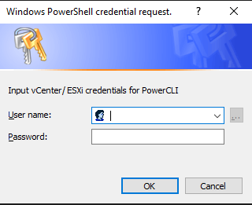

# Detect-VirtualGHOST Documentation

`Detect-VirtualGHOST.ps1` is the PowerShell script that contains the detection logic. It expects two parameters:

- Server (IP/DNS for vCenter or ESXi)
- Credential (PowerShell credential object representing username/password with privileges to access VMware management APIs)

If either of these parameters are not provided, the script will prompt for them. E.g.

```
.\Detect-VirtualGHOST.ps1

cmdlet Detect-VirtualGHOST.ps1 at command pipeline position 1
Supply values for the following parameters:
Server:
```



## Passed Credential Object

```powershell
$Credential = Get-Credential
.\Detect-VirtualGHOST.ps1 -Credential $Credential
```

## Tested VMware Versions

- vCenter
  - 8.0.2
- ESXi
  - 6.5.0
  - 7.0.3
  - 8.0.0

## Sample Output

### Positive Result Requiring Further Investigation

```
.\Detect-VirtualGHOST.ps1 -Server 192.168.122.20 -Credential $Credential
[+] Importing VMware PowerCLI module. Please wait as this might take a while...
[+] Connecting to Server: 192.168.122.20
[+] Connected to server: 192.168.122.20
[+] There are 2 hypervisors that will be checked for evidence of VirtualGHOST VMs.
WARNING: [!] ====Unregistered VM Detected on 192.168.122.52====
WARNING:
Hypervisor     VMName   VMConfigFile                                                            VMWorldID
----------     ------   ------------                                                            ---------
192.168.122.52 OpenWrt4 /vmfs/volumes/663a5dbf-a8d1533e-7af4-000c29d0e331/OpenWrt4/OpenWrt4.vmx 265959


WARNING: [!] ====Unregistered VM Detected on 192.168.122.53====
WARNING:
Hypervisor     VMName   VMConfigFile                                                            VMWorldID
----------     ------   ------------                                                            ---------
192.168.122.53 OpenWrt2 /vmfs/volumes/663a5daa-3740eb00-3ac0-000c296d56a6/OpenWrt2/OpenWrt2.vmx 265222


WARNING: This VM appears to be connected to the network(s): VM Network
WARNING:
ActiveFilters DVPortID IPAddress MACAddress        PortID    Portgroup  TeamUplink UplinkPortID vSwitch
------------- -------- --------- ----------        ------    ---------  ---------- ------------ -------
                       0.0.0.0   00:00:00:00:00:00 134217741 VM Network void       0            vSwitch0


WARNING:
Hypervisor     VMName   VMConfigFile                                                            VMWorldID
----------     ------   ------------                                                            ---------
192.168.122.53 OpenWrt5 /vmfs/volumes/663a5daa-3740eb00-3ac0-000c296d56a6/OpenWrt5/OpenWrt5.vmx 266726


WARNING: This VM appears to be connected to the network(s): dvportgroup-20
WARNING:
ActiveFilters DVPortID IPAddress MACAddress        PortID    Portgroup      TeamUplink UplinkPortID vSwitch
------------- -------- --------- ----------        ------    ---------      ---------- ------------ -------
              1        0.0.0.0   00:50:56:98:6f:04 100663310 dvportgroup-20 vmnic1     2248146951   SwitchNetwork


WARNING: [!] Unregistered VMs detected on at least one hypervisor. Please refer to the output above. There may be some false positives due to standard system lifecycles, but any results should be investigated further.
```

> [!NOTE]
> Notice the message indicating the VM is connected to a network. This means that the VM has at least one network interface attached - which should never happen on a vCLS VM.

### Negative Result - No Potential VirtualGHOST VMs Detected

```
.\Detect-VirtualGHOST.ps1 -Server 192.168.122.20 -Credential $Credential
[+] Importing VMware PowerCLI module. Please wait as this might take a while...
[+] Connecting to server: 192.168.122.20
[+] Connected to server: 192.168.122.20 | Version: 8.0.2 | ProductLine: vpx
[+] There are 2 hypervisors that will be checked for evidence of VirtualGHOST VMs.
[+] No unregistered VMs detected.
```